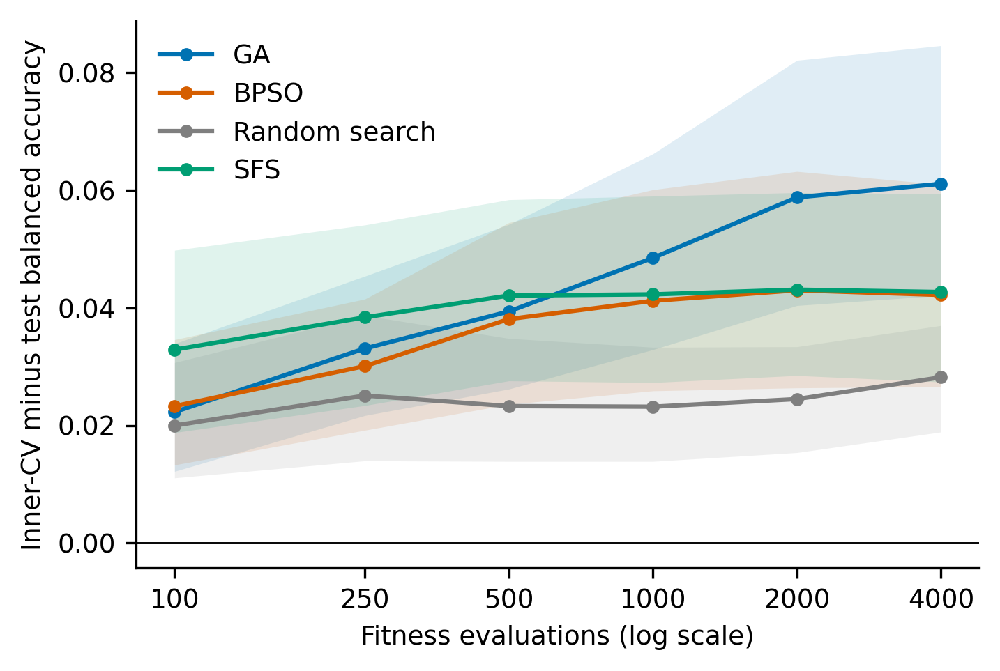
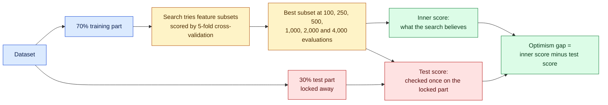

<h1 align="center">Search longer, estimate worse</h1>

<p align="center">
  <b>Evaluation budget and optimistic bias in evolutionary wrapper feature selection</b><br>
  Code, data and results for the study by Muhammad Idrees and Adnan Amin
</p>

<p align="center">
  
  
  
  
  
  
  
</p>

---

## The question

Genetic algorithms and particle swarms are popular tools for choosing which columns
(features) a machine learning model should use. They try thousands of feature subsets and
keep the one with the best cross-validation score.

Every extra try is also another chance to find a subset that scores well **by luck** on the
validation folds. So we asked a simple question:

> When a search is allowed to run longer, does it find better feature subsets,
> or does it only find subsets that *look* better?

## The answer in one picture

<p align="center">
  
</p>

The chart shows the **optimism gap**: how much the score the search believes in
(inner cross-validation) exceeds the score on data the search never saw (held-out test set).
For the genetic algorithm the gap almost **tripled** as the search ran longer, and it widened
on **all 12 datasets**. Test accuracy, meanwhile, stopped improving after about 1,000 evaluations.

## Key findings

| | Genetic algorithm | Binary PSO | Random search |
|---|:---:|:---:|:---:|
| Optimism gap after 100 evaluations | 0.022 | 0.023 | 0.020 |
| Optimism gap after 4,000 evaluations | **0.061** | **0.042** | **0.028** |
| Test balanced accuracy after 1,000 evaluations | 0.742 | 0.735 | 0.737 |
| Test balanced accuracy after 4,000 evaluations | 0.741 | 0.737 | 0.739 |

*k-nearest neighbours, mean over 12 datasets and 10 train/test splits each.*

1. **Longer search inflates the estimate, not the result.** For the genetic algorithm, the last
   3,000 evaluations took three quarters of the run time (133 of about 175 seconds per run) and changed
   test accuracy by less than 0.001.
2. **The plateau is statistically confirmed.** Equivalence tests show that test accuracy at
   4,000 and at 1,000 evaluations differs by less than one percentage point for GA and PSO.
3. **The stronger the search, the larger the optimism.** GA, which exploits its best solutions
   most, overstated its result the most. Random search overstated it the least.
4. **Random search is a strong baseline.** Drawing subset sizes uniformly, it was not
   detectably worse than GA or PSO on held-out data.
5. **The pattern holds with a second classifier.** With logistic regression the gap grew on
   all eight datasets for GA (0.023 to 0.052) and PSO (0.024 to 0.047).

## How the experiment works



The test part is touched only **after** a search has finished. Every method sees the same
splits, the same folds and the same maximum budget, and the whole design is repeated
10 times per dataset with different random splits.

## What was compared

| Method | Type | How it searches |
|---|---|---|
| Genetic algorithm (GA) | Evolutionary | Population of 30, tournament selection, uniform crossover, mutation |
| Binary particle swarm (BPSO) | Swarm | 30 particles pulled towards their own best and the swarm's best |
| Random search | Baseline | Random subsets, keeps the best one |
| Sequential forward selection (SFS) | Greedy | Adds the single most useful feature at each step |
| All features, PCA, mutual-information filter | No search | Reference points that do not search over subsets |

## Datasets

All twelve datasets are public (UCI Machine Learning Repository and OpenML) and none contain
health or personal data.

| Dataset | Rows | Features | Classes | | Dataset | Rows | Features | Classes |
|---|---:|---:|---:|---|---|---:|---:|---:|
| Red Wine | 1,359 | 11 | 2 | | Spambase | 4,210 | 57 | 2 |
| Vehicle | 846 | 18 | 4 | | Sonar | 208 | 60 | 2 |
| German Credit | 1,000 | 24 | 2 | | Libras Movement | 330 | 90 | 15 |
| Ionosphere | 350 | 33 | 2 | | Hill-Valley | 1,212 | 100 | 2 |
| Waveform | 5,000 | 40 | 3 | | Semeion | 1,593 | 256 | 10 |
| QSAR Biodegradation | 1,052 | 41 | 2 | | Madelon | 2,600 | 500 | 2 |

*Counts after removing exact duplicate rows and constant columns.*

## Checks on the code itself

| Check | What it does | Result |
|---|---|---|
| **Leakage** | Replaces every test row with random numbers and reruns the searches. A search that never looks at test data must pick exactly the same subsets. | Passed on all 12 tasks |
| **Reproducibility** | Reruns tasks from scratch and compares every subset and score with the saved results. | Passed, identical to the last digit |
| **Matched random search** | Random search that starts from the same subset sizes as GA and PSO. | Optimism ranking unchanged |
| **Duplicates kept** | Repeats three datasets without removing duplicate rows. | Test plateau unchanged |

## Reproduce the study

**1. Install**

```bash
pip install -r requirements.txt
```

**2. Prepare the data and run** (from the project root)

```bash
python src/prepare_data.py
python src/run_experiments.py
python src/run_experiments.py --classifier logreg
python src/analysis.py
python src/analysis.py --tag logreg
python src/extra_analysis.py
python src/extra_analysis.py --tag logreg
```

The main study takes about 3 hours on an eight-core laptop. Runs are saved one file at a
time, so the script can be stopped and restarted without losing work.

**3. Optional checks**

```bash
python src/verify.py
python src/run_experiments.py --methods random_bern
python src/run_experiments.py --with_duplicates
python src/revision_analysis.py
python src/margin_sensitivity.py
```

`verify.py` runs the leakage and reproducibility checks in about one minute.

**Using the saved results instead of rerunning**

All per-run results are included as zip files in `results/`. Unzip them in place and run the
analysis scripts directly:

```bash
cd results
unzip -q runs_knn.zip
unzip -q runs_logreg.zip
unzip -q runs_duplicates.zip
cd ..
python src/analysis.py
python src/analysis.py --tag logreg
python src/extra_analysis.py
python src/extra_analysis.py --tag logreg
```

## Repository layout

```
configs/experiment.yaml     every setting used in the paper
datasets/clean/             the 12 cleaned datasets
src/
  prepare_data.py           audit and cleaning of the raw data
  search_methods.py         GA, BPSO, random search and SFS
  baselines.py              all features, PCA and mutual-information filter
  run_experiments.py        the evaluation protocol
  analysis.py               main tables, statistics and figures
  extra_analysis.py         equivalence tests, sensitivity analysis, paper figures
  revision_analysis.py      matched random search and duplicate-row checks
  margin_sensitivity.py     equivalence tests with other margins
  verify.py                 leakage and reproducibility checks
results/
  tables/  stats/           every number reported in the paper
  figures/                  the three figures used in the paper
  *.zip                     one result file per dataset, split and method
```

## Citation

The paper is in preparation for submission. Until it is published, please cite it as:

```bibtex
@unpublished{idrees2026search,
  author = {Idrees, Muhammad and Amin, Adnan},
  title  = {Search longer, estimate worse: evaluation budget and optimistic bias
            in evolutionary wrapper feature selection},
  year   = {2026},
  note   = {Manuscript in preparation}
}
```

## Contact

**Muhammad Idrees**, Institute of Management Sciences, Peshawar, Pakistan<br>
[GitHub](https://github.com/idrees118) | [LinkedIn](https://www.linkedin.com/in/muhammad-idrees)

The code is released under the MIT license. The datasets keep the licences of their
original sources.
